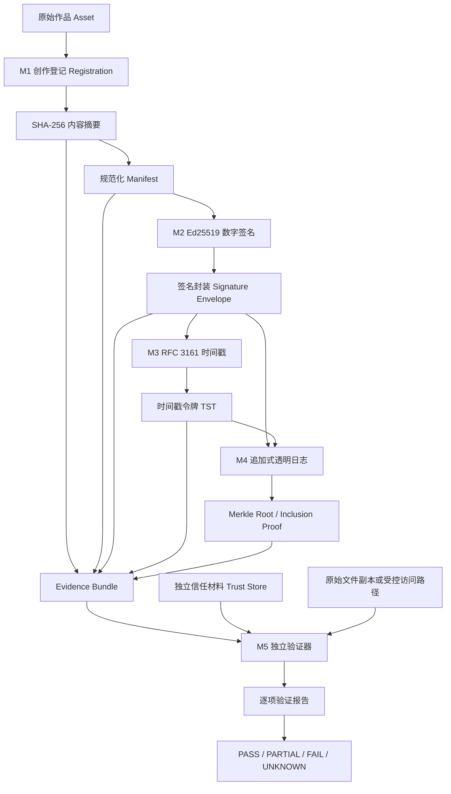
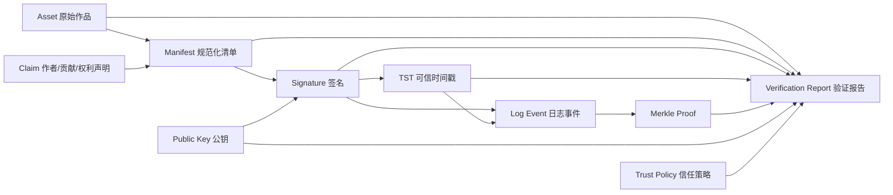
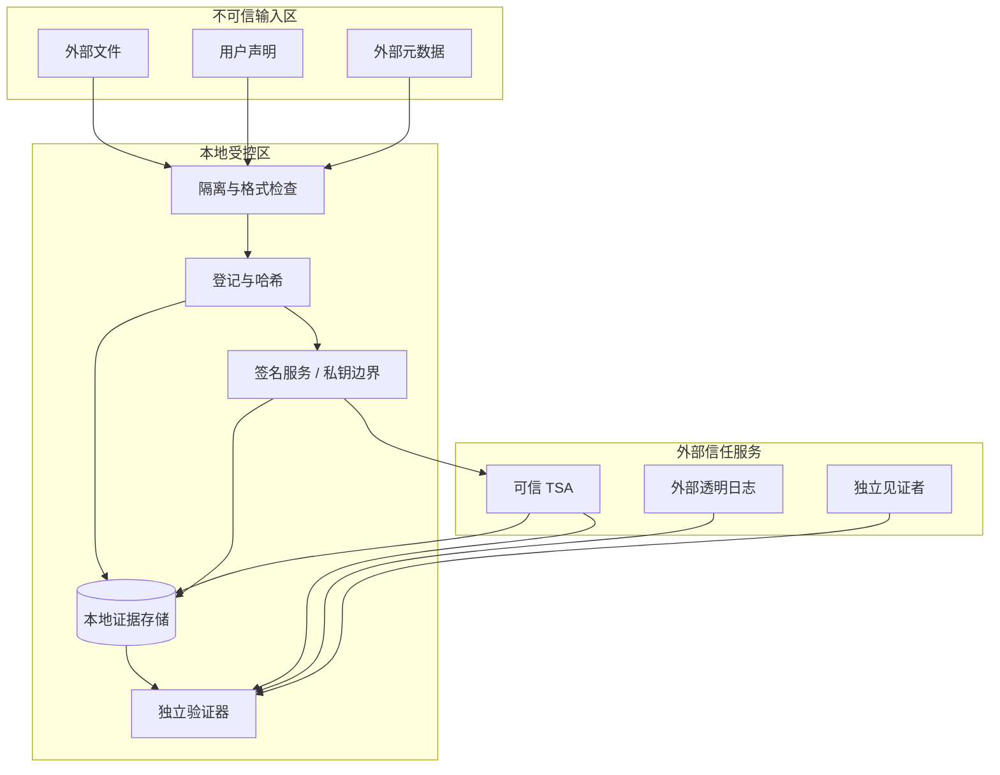
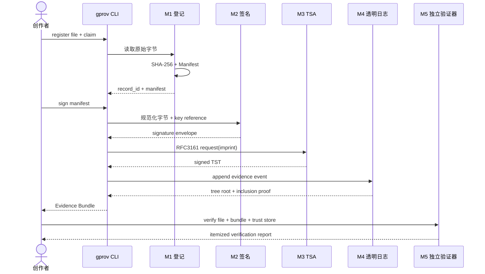
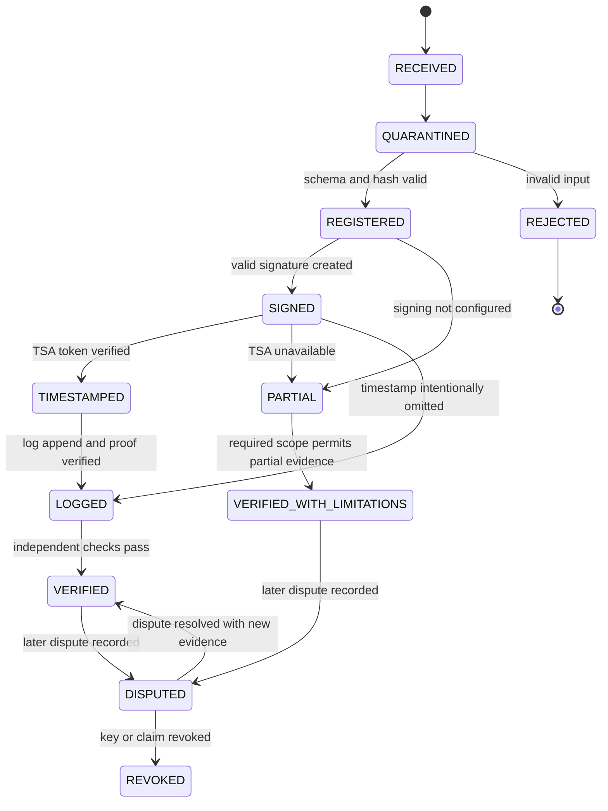
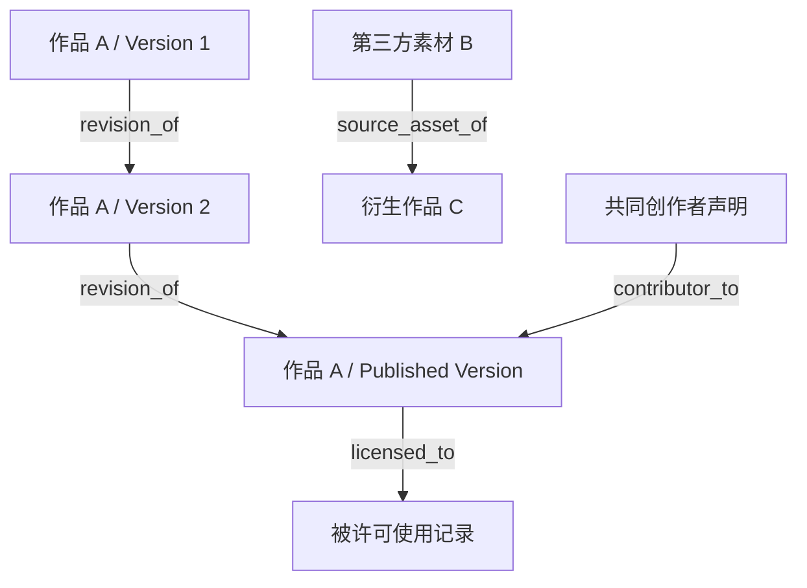
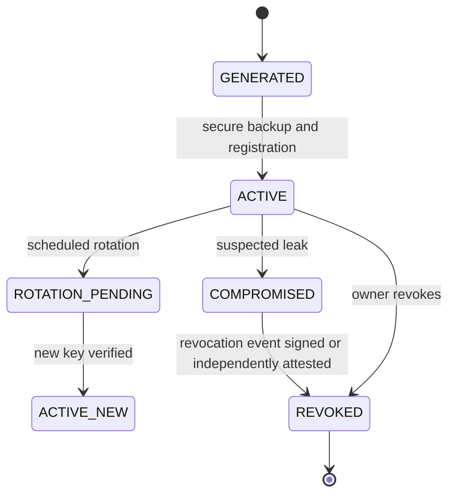

# GADIC-PROV-MVP-001｜全球可信创作与数据溯源原型

*GADIC-PROV-MVP-001 · Global Trusted Creation & Data Provenance Prototype — Technical Implementation Specification · v0.2.0*

## 文档信息

| 字段 | 内容 |
| --- | --- |
| 文档编号 | GADIC-PROV-MVP-001 |
| 版本 | v0.2.0 · DRAFT（公开知识库稿，待作者审定签发） |
| 文档性质 | 全球通用技术规范与 MVP 工程实施说明 |
| 适用范围 | 数字创作登记 · 内容完整性 · 数字签名 · 可信时间戳 · 追加式透明日志 · 独立验证 |
| 架构锚点 | #GADIC-PROV-MVP-001-2026-11-14-v0.2.0 |
| 拟定作者 | DragonSoul Maintainer |
| 拟定权利主体 | 瑞安市熵梦科技有限公司 |
| 拟签发日期 | 2026-11-14 |
| 公钥指纹 | A2D0092CEE2E5BA87035600924C3704A8CC26D5F |
| 密钥核验 | 未核验（密钥类型 / 用途 / 控制权 / 身份绑定，详见 §16） |
| 原文链接 | GADIC-PROV-MVP-001｜全球可信创作与数据溯源原型·技术落地规范 v0.2.0 |

---

> **状态声明：** 本页是技术规范与实施蓝图，不是运行报告。文档更新不代表原型已经编码、运行、测试、签名、取得 TSA 时间戳或完成第三方见证。未附真实运行证据的能力必须标记为 `NOT_RUN`、`NOT_CONFIGURED` 或 `UNKNOWN`，不得标记为 `PASS`。

**状态标记约定**

| 标记 | 含义 |
| --- | --- |
| PASS | 有真实运行证据，且验证通过 |
| PARTIAL | 部分证据缺失，或可选能力未配置 |
| NOT_RUN | 已设计，尚未执行 |
| NOT_CONFIGURED | 依赖未配置（如 TSA、外部见证者） |
| UNKNOWN | 无法判定 |
| FAIL | 验证失败 |

## 0. 版本说明与核心裁定

### 0.1 本次升级内容

v0.2.0 在 v0.1.0 基础上补全：

1. 五模块的输入、输出、依赖和失败语义。
2. 系统架构图、执行流程图、证据关系图、信任边界图。
3. 可交换的 JSON 数据结构与 CLI/API 草案。
4. Ed25519 签名范围、JSON 规范化、RFC 3161 时间戳对象及 Merkle Tree 规则。
5. 独立验证器的信任材料、逐项验证、失败降级和退出码。
6. 版本继承、作者声明、共同创作、衍生作品、授权和争议记录。
7. 密钥轮换、撤销、隐私、备份、故障恢复和跨组织验证。
8. 测试矩阵、验收门槛、实现路线与交付清单。
9. 作者签章格式与版权声明区。

### 0.2 核心裁定

本原型证明的是**证据包的完整性、签名有效性、时间戳有效性和日志包含关系**，不是自动证明法律作者身份、创意唯一性、版权资格或侵权事实。

必须分别回答：

- **内容完整性：** 当前文件是否与登记时的字节摘要一致？
- **签名有效性：** 指定公钥是否验证通过了对应声明？
- **时间证据：** 可信 TSA 是否对指定摘要签发了有效时间戳令牌？
- **日志证据：** 该事件是否包含在指定 Merkle Tree 中？树的历史是否有一致性证明？
- **身份与权利：** 公钥与现实主体的绑定依据是什么？权利声明是否存在争议？
- **法律判断：** 由适用法律、合同、事实材料和有权机构判断，不由哈希或 AI 自动裁定。

### 0.3 绝对禁止的误报

- 本机系统时间不得标成 RFC 3161 可信时间。
- 本地追加文件不得标成独立第三方透明日志。
- 自签名不得自动标成实名认证。
- 文件哈希相同不得自动标成作者相同。
- 内容相似不得自动判定抄袭。
- 日志当前可读不得自动证明历史从未被重写。
- 缺少 TSA、签名、日志证明时不得输出全链路 `VERIFIED`。
- 示例密钥、示例摘要、占位签名、模拟 TSA 响应不得进入真实证据包。

## 1. 目标、非目标与适用边界

### 1.1 第一阶段目标

将单个数字作品及其来源声明封装为可携带、可独立复核的证据包，至少包含：

- 原始文件 SHA-256 摘要；
- 规范化登记清单；
- Ed25519 数字签名；
- RFC 3161 时间戳令牌（真实 TSA 配置后）；
- 追加式透明日志事件；
- Merkle 根摘要、包含证明及一致性证明；
- 独立验证报告；
- 必要的公钥、信任锚和验证策略引用。

### 1.2 第一阶段非目标

- 不接入模型训练、微调、RAG 或自动代理。
- 不建立区块链或发行代币。
- 不宣称自动确权、自动判抄袭或自动裁定作者。
- 不保存或上传创作私钥。
- 不默认上传原始作品正文。
- 不以单一平台、单一数据库或单一企业作为全球唯一信任根。
- 不在未配置外部见证者时宣称多方见证。
- 不把本地 MVP 的测试结果夸大为全球部署结果。

### 1.3 术语

| 术语 | 定义 |
| --- | --- |
| Asset | 被登记的数字文件或数字作品 |
| Claim | 提交者对作品、贡献、来源或权利作出的声明 |
| Manifest | 机器可解析的登记清单 |
| Signature Envelope | 对规范化声明进行签名后形成的签名封装 |
| TSA | Time Stamping Authority，可信时间戳服务机构 |
| TST | RFC 3161 TimeStampToken |
| Transparency Log | 记录事件并提供 Merkle 证明的追加式日志 |
| Witness | 独立保存或核验日志检查点的见证方 |
| Evidence Bundle | 可携带的完整证据包 |
| Trust Policy | 验证者采用的公钥、证书、TSA、日志和撤销策略 |

## 2. 总体架构

### 2.1 五模块逻辑架构



### 2.2 五模块责任边界

| 模块 | 输入 | 输出 | 不负责的事项 |
| --- | --- | --- | --- |
| M1 Registration | 原始文件、声明元数据 | 内容摘要、record_id、manifest | 不证明作者身份 |
| M2 Signing | 规范化 Manifest、受保护私钥 | 签名封装、公钥引用 | 不证明密钥对应现实身份 |
| M3 Timestamping | 签名封装摘要、TSA 配置 | RFC 3161 TST、验证结果 | 不证明谁最先产生创意 |
| M4 Transparency Log | 登记事件、签名与时间戳摘要 | 日志叶子、Merkle Root、证明 | 本地日志不等于独立见证 |
| M5 Independent Verifier | 文件、Evidence Bundle、Trust Store | 逐项验证报告 | 不作法律侵权裁决 |

### 2.3 关系图：对象、证据与信任材料



**关系约束：**

- Manifest 绑定作品摘要和声明，不直接包含私钥。
- Signature 绑定 Manifest 的规范化字节。
- TST 绑定签名封装摘要，不循环包含自身。
- Log Event 记录已形成的证据摘要，不保存作品正文。
- Merkle Proof 证明事件包含在特定树根中。
- Trust Policy 决定验证者信任哪些公钥、TSA 证书链和日志签名密钥。
- Verification Report 记录实际验证结果，不反向改变原始证据。

### 2.4 信任边界图



外部文件、元数据和声明一律视为待验证数据；不得因其文本内容而获得系统权限。签名密钥只由签名边界访问，验证器默认只使用公钥和信任材料。

## 3. 端到端流程

### 3.1 标准登记流程



### 3.2 分阶段状态机



状态机不得把"跳过某项验证"自动视为通过。每次转换必须有事件记录、执行主体、策略版本和证据引用。

### 3.3 推荐执行顺序

1. 检查输入文件是否可读取，记录原始字节数和媒体类型。
2. 对原始字节计算 SHA-256。
3. 创建 Manifest，声明其规范版本、声明类型和来源关系。
4. 按 RFC 8785 JCS 规范化待签名对象。
5. 使用 Ed25519 对规范化字节签名。
6. 对签名封装计算 SHA-256，形成 TSA message imprint。
7. 请求 RFC 3161 TSA，并验证返回令牌。
8. 将 Manifest 摘要、签名摘要、TST 摘要和事件元数据追加到透明日志。
9. 取得 Merkle Root、树大小、包含证明；若支持则同时取得一致性证明。
10. 打包 Evidence Bundle。
11. 使用独立进程或独立环境执行 M5 验证。
12. 保存原始命令、退出码、验证器版本和报告摘要。

### 3.4 TSA 绑定对象的固定规则

为避免循环签名和歧义，MVP 固定以下顺序：

- `manifest_core`：不包含签名、时间戳和日志字段。
- `manifest_canonical_bytes`：对 `manifest_core` 按 RFC 8785 规范化后的字节。
- `signature_envelope`：包含 Manifest 摘要、签名算法、key_id、签名值和规范版本。
- `timestamp_imprint`：`SHA-256(JCS(signature_envelope))`。
- `timestamp_token`：TSA 对 timestamp_imprint 签发的 RFC 3161 令牌。
- `log_event`：引用 Manifest、Signature Envelope 和 Timestamp Token 的摘要。

TSA 令牌不得包含在被它自身时间戳的签名封装内；否则会形成循环依赖。

## 4. 模块实施规范

### M1｜创作登记 Registration

**输入：** 单个文件、声明类型、提交者引用、可选父版本和贡献者列表。
**输出：** `record_id`、`asset_hash`、`manifest.json`、登记事件。

要求：

- 对原始文件字节计算 SHA-256，不对未经声明的文本转换结果计算。
- 生成不可预测的 UUID/ULID 作为 record_id；ID 不作为安全凭证。
- 明确记录字节数、媒体类型、文件名（可选）、登记器版本和 Schema 版本。
- 不把文件系统 mtime 当作可信创作时间。
- 用户声明时间只能记作 `claimed_created_at`，并标注 `SELF_ASSERTED`。
- 重复哈希只能提示字节相同，不得自动判定作者相同或谁先创作。
- 原始文件默认留在创作者本地或其选择的受控存储中。

### M2｜数字签名 Signing

**算法：** Ed25519（RFC 8032）。
**规范化：** JSON Canonicalization Scheme（RFC 8785）。
**签名对象：** `manifest_core` 的规范化字节。

要求：

- 固定签名覆盖字段，不得在实现间自行增减。
- 拒绝重复 JSON 键、非规范数据和不支持的 Schema 版本。
- 公钥必须随证据包或通过可信公钥目录可获取。
- 私钥不得写入 Manifest、日志、Notion、代码仓库、普通配置文件或验证报告。
- 私钥推荐由 OS Keychain、硬件安全密钥、受控密钥代理或安全密码库管理。
- 记录 key_id、算法、密钥用途、创建/轮换/撤销事件。
- 密钥轮换时建立新旧 key 关系，并由旧密钥签署轮换声明（旧密钥可用时）；否则进入人工身份复核流程。
- 自签名只能证明某个私钥签署了某份数据，不自动证明现实身份。

### M3｜可信时间戳 Timestamping

**协议：** RFC 3161，必要时同时遵循其更新文件 RFC 5816。
**请求对象：** `SHA-256(JCS(signature_envelope))`。

验证器必须核验：

- token 的 messageImprint 与本地重新计算值一致；
- TSA 签名有效；
- TSA 证书链通向配置的信任锚；
- TSA 证书用途、有效期及策略 OID 符合配置；
- token 的 nonce（如请求使用）与响应一致；
- genTime、精度和策略信息可解析；
- 撤销状态与验证策略符合要求。

状态规则：

- 未配置 TSA：`NOT_CONFIGURED`。
- 请求尚未完成：`PENDING`。
- 网络超时或 TSA 拒绝：`FAIL` 或明确的可重试错误。
- token 验签成功：`PASS`。
- token 存在但缺少信任锚：`UNKNOWN`，不得标为可信时间戳通过。

MVP 不硬编码某家 TSA 地址。由维护者通过环境配置或受保护配置文件提供 TSA URL、信任锚和策略。测试可使用本地测试 TSA，但报告必须标明 `TEST_TSA`，不能冒充公共可信 TSA。

### M4｜追加式透明日志 Transparency Log

MVP 采用 RFC 6962 风格的 Merkle Tree 哈希构造作为技术参考，**不宣称实现了完整 Certificate Transparency 服务或符合其全部协议要求**。

固定哈希构造：

- Leaf Hash：`SHA-256(0x00 || leaf_data)`
- Node Hash：`SHA-256(0x01 || left_hash || right_hash)`

要求：

- 明确 leaf_data 的字节编码与版本。
- 每个事件有 event_id、tree_size、event_type、record_id、manifest_digest、signature_digest、timestamp_digest（可空）、event_time_observed 和 schema_version。
- 每次追加生成新的 tree_size 和 root_hash。
- 提供 inclusion proof。
- 提供 consistency proof，证明较大树是较小树的追加扩展，而非另起一棵冲突树。
- 根摘要必须由日志签名密钥签署。
- 验证者需通过可信渠道获得日志公钥或固定检查点。
- 发现同一 tree_size 对应不同 root_hash 时，标记 `LOG_FORK_DETECTED`。
- 本地日志只具备本地篡改检测能力；只有外部独立见证者保存并比对签名检查点，才可报告多方见证。

### M5｜独立验证 Independent Verification

输入：

- 原始文件或其受控读取路径；
- Evidence Bundle；
- signer public key；
- TSA trust anchors；
- transparency log public key；
- trust policy；
- 可选撤销列表和见证者检查点。

验证器必须：

- 不导入登记器内部数据库状态；
- 不依赖登记器进程内存；
- 不相信证据包内自带的公钥就是可信公钥；
- 对所有摘要重新计算；
- 对所有签名独立验签；
- 对 TSA token 独立验证；
- 对 Merkle inclusion proof 和 consistency proof 独立验证；
- 输出逐项状态、失败原因、验证器版本、策略版本和输入证据摘要；
- 支持离线验证；若必须联网查询撤销状态，应在报告中标记网络依赖与查询时间。

## 5. 标准化数据结构

### 5.1 Manifest 示例

以下是字段结构示例，所有示例值均为占位符，不得作为真实登记证据。

```json
{
  "schema_version": "gadic.asset-manifest/1.0",
  "record_id": "urn:uuid:00000000-0000-4000-8000-000000000000",
  "asset": {
    "representation": "original-bytes",
    "media_type": "text/plain",
    "size_bytes": 0,
    "hash": {
      "algorithm": "sha-256",
      "value": "REPLACE_WITH_REAL_DIGEST"
    }
  },
  "claim": {
    "claim_type": "creation_record",
    "claimant_ref": "REPLACE_WITH_SUBJECT_REFERENCE",
    "claim_status": "SELF_ASSERTED",
    "claimed_created_at": null,
    "rights_holder_claim": null,
    "license_ref": null
  },
  "contributors": [],
  "relationships": {
    "parent_assets": [],
    "source_assets": [],
    "derived_from": [],
    "replaces_record": null
  },
  "canonicalization": {
    "algorithm": "RFC8785-JCS",
    "version": "1"
  },
  "created_by": {
    "software": "gadic-prov-mvp",
    "version": "0.2.0"
  }
}
```

### 5.2 Signature Envelope 示例

```json
{
  "schema_version": "gadic.signature-envelope/1.0",
  "record_id": "urn:uuid:00000000-0000-4000-8000-000000000000",
  "manifest_digest": {
    "algorithm": "sha-256",
    "value": "REPLACE_WITH_REAL_DIGEST"
  },
  "signature": {
    "algorithm": "Ed25519",
    "key_id": "REPLACE_WITH_KEY_ID",
    "value_base64url": "REPLACE_WITH_REAL_SIGNATURE"
  },
  "signed_at_claimed": null,
  "canonicalization": "RFC8785-JCS"
}
```

### 5.3 Timestamp Evidence 示例

```json
{
  "protocol": "RFC3161",
  "imprint_algorithm": "sha-256",
  "imprint_value": "REPLACE_WITH_REAL_IMPRINT",
  "token_file": "timestamp/token.tsr",
  "tsa_policy_oid": "REPLACE_WITH_TSA_POLICY",
  "gen_time": null,
  "verification_status": "NOT_RUN",
  "trust_anchor_ref": "REPLACE_WITH_CONFIGURED_TRUST_ANCHOR"
}
```

### 5.4 Transparency Event 示例

```json
{
  "schema_version": "gadic.log-event/1.0",
  "event_id": "urn:uuid:00000000-0000-4000-8000-000000000000",
  "event_type": "ASSET_REGISTERED",
  "record_id": "urn:uuid:00000000-0000-4000-8000-000000000000",
  "manifest_digest": "sha256:REPLACE_WITH_REAL_DIGEST",
  "signature_digest": "sha256:REPLACE_WITH_REAL_DIGEST",
  "timestamp_token_digest": null,
  "tree_size": 1,
  "previous_checkpoint": null
}
```

### 5.5 Verification Report 示例

```json
{
  "schema_version": "gadic.verification-report/1.0",
  "record_id": "urn:uuid:00000000-0000-4000-8000-000000000000",
  "verifier": {
    "name": "gprov-verify",
    "version": "0.2.0"
  },
  "checks": {
    "content_hash": "NOT_RUN",
    "manifest_schema": "NOT_RUN",
    "manifest_signature": "NOT_RUN",
    "timestamp_token": "NOT_CONFIGURED",
    "log_inclusion": "NOT_RUN",
    "log_consistency": "NOT_RUN",
    "revocation": "UNKNOWN"
  },
  "overall_status": "PARTIAL",
  "limitations": [
    "Example only; no real evidence was verified"
  ]
}
```

### 5.6 字段规则

- JSON 字段名使用稳定英文标识。
- 时间使用 RFC 3339 格式，必须携带 UTC 标记或明确时区偏移。
- 哈希算法必须显式记录，不能只保存裸摘要字符串。
- 大整数、二进制和字节长度必须定义序列化方式。
- Schema 版本必须可识别；未知字段应按兼容策略处理，不得静默丢弃安全关键字段。
- 对签名对象使用 RFC 8785 JCS；禁止依赖不同语言默认 JSON 序列化结果。
- 原始字节摘要与文本规范化摘要是不同对象，必须分别命名和记录。
- 任何可选字段被省略时，必须定义其语义；不得混淆 null、空字符串和字段缺失。

## 6. 证据包与目录规范

### 6.1 建议目录

```
gadic-prov-mvp/
├── README.md
├── LICENSE
├── pyproject.toml
├── schemas/
│   ├── asset-manifest.schema.json
│   ├── signature-envelope.schema.json
│   ├── log-event.schema.json
│   └── verification-report.schema.json
├── src/
│   └── gprov/
│       ├── registration/
│       ├── signing/
│       ├── timestamping/
│       ├── transparency/
│       ├── verification/
│       ├── canonicalization/
│       └── cli/
├── tests/
│   ├── unit/
│   ├── integration/
│   ├── security/
│   └── fixtures/
├── docs/
│   ├── architecture.md
│   ├── threat-model.md
│   ├── key-management.md
│   ├── timestamp-policy.md
│   └── interoperability.md
├── examples/
│   └── synthetic-evidence/
└── reports/
    ├── test-report.template.md
    └── verification-report.template.json
```

真实作品和私钥不得放进公开源码仓库。测试夹具只能使用合成数据或获得明确许可的样本。

### 6.2 Evidence Bundle

```
evidence-bundle/
├── manifest.json
├── signature-envelope.json
├── signer-public-key.pem
├── timestamp/
│   ├── request.tsq
│   ├── token.tsr
│   └── tsa-chain.pem
├── transparency/
│   ├── event.json
│   ├── checkpoint.json
│   ├── inclusion-proof.json
│   ├── consistency-proof.json
│   └── log-public-key.pem
├── trust/
│   ├── trust-policy.json
│   └── revocation-snapshot.json
└── reports/
    └── verification-report.json
```

原始作品可作为独立文件交给验证器，不强制复制进证据包。证据包中的公钥、证书和策略仍需通过可信渠道确认，不能因为它们与证据放在同一个 ZIP 中就自动信任。

## 7. 通用 CLI 与 API 契约

### 7.1 CLI 命令草案

```bash
# 1. 登记文件：生成 manifest 和内容摘要
gprov register ./作品文件.pdf --out ./evidence/record-001

# 2. 查看待签名清单摘要
gprov inspect ./evidence/record-001/manifest.json

# 3. 使用本地密钥引用签名；不得把私钥内容作为命令行参数
gprov sign ./evidence/record-001/manifest.json --key-ref local:keychain/gadic-author

# 4. 对签名封装请求真实 TSA 时间戳
gprov timestamp ./evidence/record-001 --tsa-config ./config/tsa.json

# 5. 追加透明日志并生成 Merkle 证明
gprov log append ./evidence/record-001

# 6. 使用独立验证器重新验证
gprov verify ./作品文件.pdf ./evidence/record-001   --trust-policy ./config/trust-policy.json

# 7. 输出机器可读状态
gprov verify ./作品文件.pdf ./evidence/record-001 --format json
```

以上命令是接口契约草案，不代表当前已有可执行程序。实际参数必须以代码实现、CLI help 和集成测试为准。

### 7.2 API 路由建议

| Method | Endpoint | 功能 |
| --- | --- | --- |
| POST | /v1/records | 创建登记记录 |
| GET | /v1/records/{record_id} | 读取登记清单 |
| POST | /v1/records/{record_id}/sign | 生成签名封装 |
| POST | /v1/records/{record_id}/timestamp | 请求 RFC 3161 时间戳 |
| POST | /v1/log/events | 追加透明日志事件 |
| GET | /v1/log/checkpoints/latest | 获取最新签名检查点 |
| GET | /v1/log/proofs/{event_id} | 获取包含证明 |
| POST | /v1/verify | 独立验证证据包 |
| POST | /v1/keys/revocations | 登记密钥撤销事件 |

API 必须具备身份认证、速率限制、输入 Schema 校验、请求幂等性、审计事件和明确错误码。MVP 本地 CLI 可先实现核心能力，HTTP API 不应成为第一阶段的强制依赖。

### 7.3 通用错误码

| 错误码 | 含义 | 建议处理 |
| --- | --- | --- |
| E_INPUT_INVALID | 输入文件或字段无效 | 拒绝登记 |
| E_SCHEMA_UNSUPPORTED | Schema 版本不支持 | 隔离并提示升级 |
| E_HASH_MISMATCH | 文件摘要不一致 | 验证失败 |
| E_SIGNATURE_INVALID | 数字签名无效 | 验证失败 |
| E_KEY_UNTRUSTED | 公钥未被信任策略认可 | UNKNOWN / 需核验 |
| E_TSA_NOT_CONFIGURED | 未配置 TSA | PARTIAL |
| E_TSA_UNAVAILABLE | TSA 不可用 | PENDING 或 FAIL |
| E_TSA_TOKEN_INVALID | TSA token 验证失败 | FAIL |
| E_LOG_PROOF_INVALID | Merkle 证明无效 | FAIL |
| E_LOG_FORK | 同一树大小出现冲突根 | 安全事件 |
| E_KEY_REVOKED | 密钥已撤销 | 按撤销策略判断 |
| E_EVIDENCE_INCOMPLETE | 证据包不完整 | PARTIAL |
| E_POLICY_UNAVAILABLE | 信任策略不可用 | UNKNOWN |

## 8. 独立验证规则

### 8.1 验证顺序

1. 解析证据包，拒绝路径穿越、恶意压缩包和超限文件。
2. 验证 Manifest Schema。
3. 重新读取原始文件并计算 SHA-256。
4. 按声明的规范版本重建 JCS 字节。
5. 从可信来源解析 signer public key。
6. 验证 Ed25519 签名。
7. 对签名封装重新计算 timestamp imprint。
8. 验证 RFC 3161 token、TSA 证书链和信任策略。
9. 重新计算 Log Event leaf hash。
10. 验证 Merkle inclusion proof。
11. 验证日志检查点签名及 consistency proof。
12. 查询或验证密钥撤销事件。
13. 输出逐项报告和整体摘要。

### 8.2 整体状态规则

| 条件 | 整体状态 |
| --- | --- |
| 所有必需项均通过，且信任材料有效 | VERIFIED |
| 部分可选能力未配置，必需项通过 | VERIFIED_WITH_LIMITATIONS |
| 缺少必要证据或信任材料 | PARTIAL / UNKNOWN |
| 任一必需密码学验证失败 | FAIL |
| 发现日志分叉或签名伪造 | FAIL + SECURITY_EVENT |
| 权利归属存在争议 | DISPUTED（不等于密码学验证失败） |

密码学验证状态和权利争议状态是两个维度。例如，一份签名完全有效的作品仍可能存在作者归属争议；一份作品没有 TSA 也不等于作品是伪造的。

### 8.3 退出码建议

| Exit Code | 含义 |
| --- | --- |
| 0 | 所有配置为必需的验证项通过 |
| 1 | 验证失败 |
| 2 | 证据不完整或结果未知 |
| 3 | 配置错误或依赖不可用 |
| 4 | 检测到日志分叉或高风险安全事件 |

CLI 输出必须同时提供人类可读文本与机器可解析 JSON。

## 9. 作者、贡献、版本与权利关系

### 9.1 不采用单一作者字段解决所有权利问题

作品可以有：

- 单一作者；
- 多名共同创作者；
- 编辑者；
- 翻译者；
- 受委托制作方；
- 权利受让方；
- 许可使用方；
- 来源素材提供者；
- AI 工具参与记录。

Manifest 应区分 `creator`、`contributor`、`claimant`、`rights_holder_claim`、`license_ref` 和 `source_asset`。这些角色不应默认相等。

### 9.2 版本关系图



每个新版本产生新的内容摘要和登记事件。旧版本不得被覆盖。衍生关系、素材来源和许可条件必须由提交者声明并保留证据引用。

### 9.3 归属争议处理

争议记录采用追加事件：

- `CLAIM_SUBMITTED`
- `COAUTHOR_ADDED`
- `SOURCE_ASSET_DECLARED`
- `LICENSE_GRANTED`
- `CLAIM_DISPUTED`
- `EVIDENCE_ADDED`
- `CLAIM_CORRECTED`
- `KEY_ROTATED`
- `KEY_REVOKED`
- `DISPUTE_RESOLVED`

不得删除原声明来掩盖争议。纠错应追加新声明并关联被纠正事件。验证器显示当前状态时，必须能追溯历史状态和证据。

## 10. 密钥管理、撤销与恢复

### 10.1 密钥生命周期



### 10.2 要求

- 私钥优先使用 OS Keychain、硬件安全模块或受控密钥代理。
- 私钥备份必须加密并由所有者控制。
- 不允许把私钥写入环境变量、命令历史、日志、Notion 或代码仓库。
- 公钥指纹必须说明算法、编码方式和计算对象。
- 发生泄露时立即停止使用旧密钥，登记撤销事件并生成新密钥。
- 历史签名是否仍可接受，应结合可信时间戳、密钥有效期、泄露时间证据和验证策略判断。
- 无法确定泄露时间时，不得擅自声称泄露前签名必然安全。
- 证据包应携带或引用密钥状态快照，验证器应报告快照时间和新鲜度。

## 11. 隐私、跨境与多方见证

### 11.1 数据最小化

透明日志默认只记录摘要、最小事件元数据和证明引用，不记录作品全文、私钥、身份证件或不必要的个人信息。

### 11.2 跨机构互操作

不同机构可分别运营：

- TSA 服务；
- 透明日志；
- 见证节点；
- 公钥目录；
- 证据镜像；
- 独立验证器。

参与者通过开放 Schema、签名算法标识、时间戳协议和 Merkle 证明互相验证，而不是依赖单一厂商账户。

### 11.3 多方见证

真正的多方见证至少要求：

1. 独立运营主体；
2. 不同管理权限；
3. 独立保存签名检查点；
4. 定期交换并验证 tree head；
5. 能发现同一 tree_size 的冲突 root；
6. 保存见证时间和签名证据。

同一台服务器上的两个进程、同一企业控制的两个数据库，不应被宣传为两个独立见证方。

### 11.4 删除与更正

不可篡改日志不意味着可以无限保留个人数据。敏感内容应留在受控存储；日志只保存法律允许保留的最小证明信息。删除原始作品时，日志应追加删除/限制访问事件，而不是声称可以从哈希恢复原文。

## 12. 安全威胁与缓解措施

| 威胁 | 控制措施 | 残余风险 |
| --- | --- | --- |
| 文件被替换 | 原始字节哈希复核 | 无法仅凭哈希证明作者 |
| Manifest 被修改 | JCS + Ed25519 | 私钥泄露仍可伪造新签名 |
| 时间戳伪造 | TSA token 与证书链验证 | TSA 本身可能失陷或停运 |
| 日志被重写 | Merkle proof、签名检查点、一致性证明 | 无外部见证时仍可能被整体重建 |
| 日志分叉 | 多方见证与 tree-head 比对 | 见证者串通或全部离线 |
| 公钥替换 | 独立信任策略、指纹核验 | 身份绑定仍需额外证明 |
| 证据包恶意文件 | 沙箱解析、路径与大小限制 | 解析器漏洞 |
| 元数据伪造 | 声明与验证结果分离 | 现实事实需外部证据 |
| 密钥遗失 | 加密备份、轮换与恢复流程 | 无备份时历史证明受限 |
| 隐私泄露 | 数据最小化、访问控制 | 摘要和元数据仍可能泄露关联信息 |

## 13. 测试矩阵与真实验收

所有测试在实际执行前均为 `NOT_RUN`。

| ID | 测试场景 | 预期结果 |
| --- | --- | --- |
| T-001 | 同一文件重复计算 SHA-256 | 摘要一致 |
| T-002 | 修改文件一个字节 | 内容哈希验证失败 |
| T-003 | 正确公钥验证签名 | PASS |
| T-004 | 错误公钥验证签名 | FAIL |
| T-005 | 签名后修改 Manifest | FAIL |
| T-006 | JSON 字段顺序不同但语义相同 | JCS 字节一致 |
| T-007 | JSON 重复键 | 拒绝或明确 FAIL |
| T-008 | 未配置 TSA | NOT_CONFIGURED，不生成假令牌 |
| T-009 | 有效 RFC 3161 token | messageImprint、签名和链验证通过 |
| T-010 | 篡改 TSA token | FAIL |
| T-011 | TSA 证书链不受信任 | UNKNOWN / FAIL，按策略明确区分 |
| T-012 | 透明日志正常追加 | tree_size 增长、root 可复算 |
| T-013 | 修改日志叶子数据 | inclusion proof 失败 |
| T-014 | 错误 Merkle path | FAIL |
| T-015 | consistency proof 有效 | 证明旧树为新树前缀 |
| T-016 | 同一 tree_size 出现不同 root | LOG_FORK_DETECTED |
| T-017 | 删除本地日志尾部 | 与外部检查点比对后发现截断 |
| T-018 | 证据包缺少时间戳 | PARTIAL，不得全链路 VERIFIED |
| T-019 | 独立验证器在干净环境运行 | 不依赖登记器数据库 |
| T-020 | 私钥扫描 | 证据包和仓库中无私钥材料 |
| T-021 | 撤销密钥后验证历史签名 | 按撤销时间和策略输出明确结论 |
| T-022 | 恶意压缩包/路径穿越 | 安全拒绝，不写出隔离目录 |
| T-023 | 网络断开 | 离线可验证项继续验证，在线依赖标 UNKNOWN |
| T-024 | TSA 超时 | 有界重试，明确失败，不伪造成功 |
| T-025 | 日志检查点签名错误 | FAIL |

### 13.1 测试报告模板

```
Project: GADIC-PROV-MVP-001
Build/Commit:
Verifier Version:
OS / Runtime:
Dependency Lock Hash:
Test Date (RFC3339):
Test Command:
Total:
Passed:
Failed:
Skipped:
Not Run:
External Services:
Raw Output Path:
Evidence Bundle Hash:
Known Limitations:
Reviewer:
Review Status:
```

### 13.2 验收门槛

进入受控试用前必须：

- M1 至 M5 均有可运行实现；
- 签名覆盖范围与 JCS 规则冻结；
- Ed25519 有正确/错误密钥测试；
- RFC 3161 使用真实 TSA 时完成 token 与证书链验证；未配置时如实降级；
- Merkle inclusion 与 consistency proof 有测试向量；
- 日志检查点由日志密钥签名；
- 独立验证器能在干净环境重验；
- 密钥管理、撤销、备份与恢复流程经过演练；
- 安全测试和隐私扫描有真实报告；
- 每项测试保留命令、原始输出和版本信息。

## 14. 实施路线与交付清单

### Phase 0｜规范冻结

- [ ]  确认 Manifest Schema。
- [ ]  固定 RFC 8785 规范化范围。
- [ ]  固定签名覆盖字段。
- [ ]  固定 TSA imprint 对象。
- [ ]  固定 Merkle 叶子与节点编码。
- [ ]  固定状态枚举和退出码。
- [ ]  形成公开测试向量。

### Phase 1｜本地最小证据链

- [ ]  M1：SHA-256 登记。
- [ ]  M2：Ed25519 签名和验签。
- [ ]  M5：独立验证 Manifest 与签名。
- [ ]  CLI 和 JSON 报告。
- [ ]  合成样本端到端测试。

### Phase 2｜真实可信时间戳

- [ ]  TSA 配置与信任锚管理。
- [ ]  RFC 3161 请求生成。
- [ ]  token、messageImprint、证书链验证。
- [ ]  未配置、超时、错误响应测试。
- [ ]  真实 TSA 运行证据归档。

### Phase 3｜透明日志

- [ ]  追加式事件存储。
- [ ]  Merkle Root。
- [ ]  Inclusion Proof。
- [ ]  Consistency Proof。
- [ ]  签名检查点。
- [ ]  日志篡改、截断和分叉测试。

### Phase 4｜独立验证与发布准备

- [ ]  干净环境验证。
- [ ]  证据包导出与导入。
- [ ]  公钥信任策略。
- [ ]  撤销与密钥轮换。
- [ ]  故障恢复。
- [ ]  安全审查。
- [ ]  生成可复现运行报告。

### Phase 5｜跨机构见证（MVP 之后）

- [ ]  第二个独立日志运营者。
- [ ]  外部见证者检查点签名。
- [ ]  多方 tree-head 比对。
- [ ]  公共验证端点。
- [ ]  跨平台互操作测试。

**AI 数据投毒防护不纳入本次五模块 MVP。** 只有本阶段的证据链完成并通过独立验证后，才进入第二阶段的数据隔离、训练数据准入、RAG 来源绑定和提示注入防护。

## 15. 公开标准与技术参考

以下标准应在实现时按正式文本核对版本、适用范围和更新状态：

1. RFC 3161 — Internet X.509 Public Key Infrastructure Time-Stamp Protocol
https://www.rfc-editor.org/rfc/rfc3161.html
2. RFC 5816 — ESSCertIDv2 Update for RFC 3161
https://www.rfc-editor.org/rfc/rfc5816.html
3. RFC 8032 — Edwards-Curve Digital Signature Algorithm (EdDSA)
https://www.rfc-editor.org/rfc/rfc8032.html
4. RFC 8785 — JSON Canonicalization Scheme (JCS)
https://www.rfc-editor.org/rfc/rfc8785.html
5. RFC 6962 — Certificate Transparency（Merkle Tree 构造与证明设计参考；本项目不宣称完整 CT 合规）
https://www.rfc-editor.org/rfc/rfc6962.html
6. W3C PROV-O — The PROV Ontology
https://www.w3.org/TR/prov-o/
7. C2PA Technical Specifications — Content Credentials 与媒体来源声明互操作参考
https://spec.c2pa.org/
8. Sigstore Rekor — Transparency Log 参考实现
https://docs.sigstore.dev/logging/overview/

标准引用不等于本项目已经符合相应标准。正式发布前应记录具体采用版本、兼容范围和测试依据。

## 16. 签章与版权声明

**文档编号：** GADIC-PROV-MVP-001
**版本：** v0.2.0（DRAFT）
**架构锚点：** #GADIC-PROV-MVP-001-2026-11-14-v0.2.0
**拟定作者：** DragonSoul Maintainer
**拟定权利主体：** 瑞安市熵梦科技有限公司
**拟签发日期：** 2026-11-14
**公钥指纹：** A2D0092CEE2E5BA87035600924C3704A8CC26D5F

---

**版权声明：** 本文为拟由作者及拟定权利主体发布的原创技术文档。建议采用 Creative Commons Attribution-ShareAlike 4.0 International（CC BY-SA 4.0）许可；正式生效前须由权利主体确认其有权授权，并确认文中第三方标准、引用材料和代码示例的许可边界。转载或改编时应保留作者署名、原文出处、许可链接及修改说明。

许可文本：https://creativecommons.org/licenses/by-sa/4.0/

**原文链接：** 以上 Notion 页面为本文件当前版本的知识库原文地址。若未来在 CSDN 或其他平台发布，应在发布后将该平台的实际文章 URL 追加到本区，不得预先编造链接。

**作者提供的既有参考文章：**
https://blog.csdn.net/dragonsoul/article/details/170744240

### 数字签章状态

| 项目 | 内容 |
| --- | --- |
| 签署主体 | 待作者签署 |
| 签名算法 | 拟 Ed25519（以实际密钥为准） |
| 签署对象 | 冻结后的 v0.2.0 Markdown 文件及其 SHA-256 |
| 文档 SHA-256 | 52ef329aa7c146b9f5e5b73afd55b3f453ab252d61bd2439d03a4c5d9b2aa78b |
| 摘要对象 | 本地冻结文件（UTF-8 · 41,194 字节 · 1,058 行 · 按原始字节计算） |
| 计算时间 | 2026-11-14T04:43+08:00（本机系统时间 · SELF_ASSERTED） |
| 交叉校验 | SHA-1 37add6719480542078fd962c35cda1ae2a9d9977 · MD5 3def5ddb973c74d9559aa15a95524c49 |
| 数字签名 | NOT_GENERATED |
| RFC 3161 时间戳 | NOT_ATTACHED |
| 透明日志登记 | NOT_REGISTERED |
| 独立验签 | NOT_VERIFIED |
| 签发状态 | DRAFT_UNSIGNED |

**回填说明：** 上述摘要对应「回填前」的本地冻结文件。本页回填后若再次导出 Markdown，字节必然变化，须另算新摘要并记为 v0.2.0-hashfix，不得沿用本值。

**签章安全说明：** 公钥指纹文本本身不是签名，也不能证明现实身份。正式签发时，作者必须使用本人控制的私钥，对最终冻结版本的规范化签署清单进行签名；随后由独立验证器验签，并按需取得可信时间戳和透明日志证明。任何私钥、助记词或私密凭证均不得粘贴到 Notion、聊天或公开仓库。

---

## 17. 当前实施状态与后续记录

| 项目 | 当前状态 | 说明 |
| --- | --- | --- |
| 技术规范 v0.2.0 | DRAFT | 本次完成文档设计，不代表代码实现 |
| M1 创作登记 | NOT_RUN | 待原型实现与测试 |
| M2 数字签名 | NOT_RUN | 待密钥边界和签名实现 |
| M3 RFC 3161 | NOT_CONFIGURED | 尚未提供真实 TSA 配置与信任锚 |
| M4 透明日志 | NOT_RUN | 待 Merkle Tree 与证明实现 |
| M5 独立验证 | NOT_RUN | 待独立验证器实现 |
| 外部多方见证 | NOT_CONFIGURED | 尚无独立见证者 |
| 作者数字签章 | NOT_GENERATED | 待作者实际签署 |
| AI 数据投毒防护 | OUT_OF_SCOPE | 第二阶段单独设计 |

**结论：** 本项目的最小可交付物不是一个漂亮的登记网页，而是一个可携带、可复核、可独立验证的数字证据包。只有真实代码、真实密钥、真实 TSA 令牌、真实日志证明和独立验证报告全部形成后，才能将相应能力从设计状态更新为运行通过。

---

**文档维护规则：** 每次版本升级必须保留旧版本、变更摘要、差异说明、测试结果和新的文档摘要；已签发版本不得原位覆盖，修订应形成新版本并通过新证据链关联旧版本。

<!-- 🧬 #龍芯⚡️丙午·己亥·壬辰·癸卯·䷟恒-文档-创建-4d097466 -->
